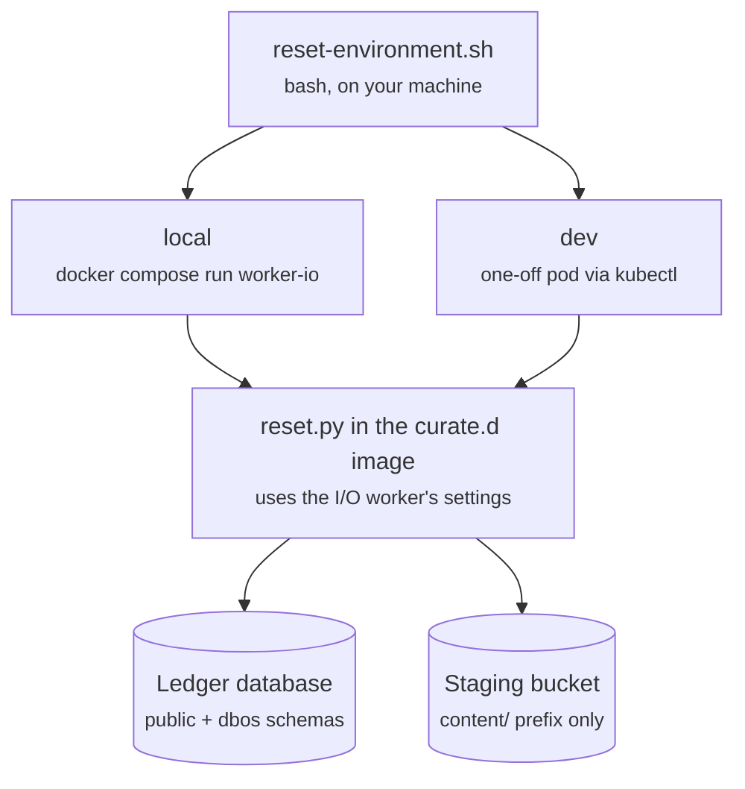

# Environment reset

[`infrastructure/reset/reset-environment.sh`](../infrastructure/reset/reset-environment.sh)
wipes `local` or `dev` back to an empty ledger and an empty staging content prefix. There is no
production path: the script only accepts `local` and `dev`.

```bash
infrastructure/reset/reset-environment.sh local|dev [--execute [--yes]] [--drop-connections]
```

Without `--execute` it is a dry run: it prints the rows and objects a reset would remove and
changes nothing. With `--execute` it asks you to type `reset <env>`, unless `--yes` is given.

Locally, `make stack-reset` (`docker compose down -v`) is the cruder alternative: it destroys
every volume, provider connections included, and the next `make stack-up` comes up on empty volumes.

## Where it runs

Two files:

- `reset-environment.sh` is the bash driver you run. It owns confirmation, stopping and
  restarting workloads, and the cluster's reconciler.
- [`reset.py`](../infrastructure/reset/reset.py) is the part that touches data. The script
  passes it to `python -c` inside the curate.d image, so it runs with the I/O worker's database
  URL and staging writer identity. No credentials reach your machine, no secret
  changes, and nothing is installed into the application.



Inside the container the order is: wipe, `alembic upgrade head` to rebuild the schema, then
restore the provider connections.

## What happens to the data

| Where | What | Result |
| --- | --- | --- |
| Ledger database (`curate_d`) | Application tables in `public` | wiped, recreated empty by migrations |
| | DBOS tables in `dbos` (workflows, steps, queues, schedules, versions) | wiped, recreated empty by migrations |
| | `provider_connections` | set aside, restored as stored (pCloud stays authorized) |
| | PostGIS `spatial_ref_sys` and other extension objects | kept |
| | Audit triggers | recreated by migrations |
| | The database pod itself | keeps running |
| Staging bucket | Objects under `content/` | deleted |
| | Unfinished multipart uploads under `content/` | aborted |
| | Readiness marker at `content/` | kept |
| | Anything outside the prefix | untouched |

DBOS has no separate database here: its system tables are the `dbos` schema inside the ledger
database (see [CLAUDE.md](../CLAUDE.md#dbos)), so wiping the ledger wipes DBOS too.

`--drop-connections` wipes the provider connections as well; every account must then be
authorized again. If a run fails after setting the connections aside, they stay in the
`curate_d_reset` schema and the next run restores them.

## A dev (Kubernetes) run, step by step

Each pod in `<namespace>` across the phases of `reset-environment.sh dev --execute`:

| | 1 Plan | 2 Confirm | 3 Stop app | 4 Wipe + migrate | 5 Restart infra | 6 App back |
| --- | --- | --- | --- | --- | --- | --- |
| API | running | running | scaled to 0 | stopped | stopped | **new pod** |
| worker-io | running | running | scaled to 0 | stopped | stopped | **new pod** |
| worker-cpu | running | running | scaled to 0 | stopped | stopped | **new pod** |
| reset pod | reads only | – | – | **wipes** | – | – |
| connection infrastructure | running | running | running | sessions cut | **restarted** | running |
| database | running | running | running | running | running | running |
| reconciler on the app | on | on | **off** | **off** | **off** | on again |

- **Stop the app.** Before scaling the API and workers to 0, the script annotates each one
  `kustomize.toolkit.fluxcd.io/reconcile: disabled`, which keeps the reconciler from bringing them back
  mid-wipe, and records its replica count in `curate-d/reset-replicas` on the same object. Phase
  6 scales them back to those counts and removes both annotations.
- **Wipe and migrate.** The reset pod is built from the I/O worker's pod template. It refuses
  while a worker still holds its executor lease, ends every other database session the
  application role holds (any connection pooler's included), then wipes and migrates.
- **Restart infrastructure.** Connection infrastructure restarts so it drops server connections and prepared
  statements that point at dropped objects. The database is
  never restarted: the wipe is plain SQL and does not need it.

## Local and dev side by side

| | local | dev (Kubernetes) |
| --- | --- | --- |
| Runs the reset in | `docker compose run worker-io` | a one-off pod from the `worker-io` template |
| Stops first | `api`, `worker-io`, `worker-cpu` | the same three, scaled to 0, the reconciler kept off them |
| Restarts after | every service except `postgres` | connection infrastructure, then the API and workers |
| Waits for | `docker compose up -d --wait` (healthy) | `rollout status` on every workload |
| Needs on your machine | the stack's `CURATE_D_CREDENTIAL_ENCRYPTION_KEY` exported, as for `make stack-up` | a kubectl context for the cluster, and `jq` |

## What it refuses

| Situation | Result |
| --- | --- |
| `prod`, or any environment but `local` or `dev` | usage, exit 2 |
| The target is configured (`CURATE_D_ENVIRONMENT`) for a different environment | `refused: asked to reset dev, but this container is configured for …`; dev checks ConfigMap `curate-d-config` first: `namespace <namespace> is configured for …, not dev` |
| local: `postgres` or `rustfs` not running, or `CURATE_D_CREDENTIAL_ENCRYPTION_KEY` not exported | stops before the plan; nothing changed |
| A worker still holds its executor lease | `refused: workers still hold their leases` |
| A table owned by another role would survive the wipe | `refused`, and the wipe rolls back |
| `--execute` without a terminal and without `--yes` | stops; nothing changed |
| The typed confirmation is not `reset <env>` | stops; nothing changed |

## If something fails

| Fails during | State afterwards | Recovery |
| --- | --- | --- |
| Plan or confirm | nothing changed | none needed |
| Wipe or migrate (dev) | API and workers at 0, the reconciler kept off them | rerun the script: it restores the recorded replicas |
| Wipe or migrate (local) | API and workers stopped | rerun the script |
| Migrate, after the connections were set aside | connections held in `curate_d_reset` | the next run restores them |

To hand the dev workloads back to the reconciler by hand instead of rerunning:

```bash
kubectl -n <namespace> annotate deployment/curate-d-api statefulset/curate-d-worker-io statefulset/curate-d-worker-cpu kustomize.toolkit.fluxcd.io/reconcile- curate-d/reset-replicas-
```

## After the version lease first rolls out

Builds from before the recovery sweep never registered in `lease_versions` and hold no version
lock, so the sweep leaves their stranded rows alone and logs
`recovery_sweep.unregistered_version` each tick (see [recovery.md](recovery.md)). Once the
first lock-holding build has rolled out on both `worker-io` and `worker-cpu`, reset `dev` and
`local` once to clear those rows; locally, run `make image` from that build first. A reset
also empties `lease_versions`, and the workers register again as they restart.

## Examples

Preview a dev reset (changes nothing):

```bash
infrastructure/reset/reset-environment.sh dev
```

Reset dev, typing `reset dev` when asked:

```bash
infrastructure/reset/reset-environment.sh dev --execute
```

Reset the local stack without the prompt:

```bash
infrastructure/reset/reset-environment.sh local --execute --yes
```
