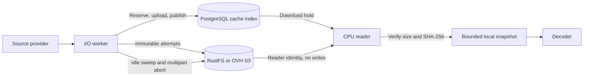

# S3 content staging

Curate.d uses one S3 adapter for RustFS in local development/CI and OVH Standard S3 in
Kubernetes. RustFS replaced MinIO, whose upstream is archived
([Local engine: RustFS](#local-engine-rustfs)). The runtime, cache coordination, snapshot reader and provisioning smoke
command are implemented. Local success does not establish
remote compatibility: see the
[compatibility matrix](../infrastructure/staging-compatibility.md).

This implements the [S3 staging contract](../openspec/specs/content-staging/spec.md)
and consumes the already-reconciled staging decision.
The ingest and classification workflows stage and read through it.

## Authority and data flow



The I/O factory returns `StagingWriterBackend`: a `StagingObjectStore`, a
`CoordinatedStagingIndex`, and `StagingOccupancy`. The CPU factory returns
`StagingReaderBackend` with a `LocalSnapshotReader` and the process-wide
`LocalScratchBudget`. Its internal adapters expose only `StagingDownloadStore.download`
and `StagingDownloadHold.hold_for_download`. The CPU surface has no upload, registration,
release or eviction method. Both roles use explicit, distinct S3 credentials; CPU has no
source-provider or backup authority.

`StagingCacheIndex`, `CoordinatedStagingIndex`, and `StagingDownloadHold` retain separate
interfaces. Application collaborators should accept these protocols rather than concrete
PostgreSQL or S3 implementations. Construction lives in
[factories.py](../src/curate_d/staging/factories.py); storage contracts live in
[objects.py](../src/curate_d/staging/objects.py).

The writer takes the global PostgreSQL advisory lock twice per publication, for its
admission and its registration, and never for the upload. Admission (`occupancy.reserve`)
measures the listing plus the bytes of live reservations, reclaims under pressure
(reconciliation first deletes expired reservations), inserts this attempt's row in
`staging_reservations`, and commits; bytes it evicted are deleted after that commit. The
upload then runs unlocked under its reservation, which every worker counts as occupancy,
so admissions on different pods proceed side by side and still cannot spend the same
headroom. Registration (`occupancy.register`) consumes the reservation and inserts the
registration row in one transaction. Entry locks reclamation takes end with the admission
holding, so a reader waits at most for one reclamation, never for a transfer.

A reservation ends in exactly one of three ways:

- **Consumed** by the registration of its attempt.
- **Abandoned** (`occupancy.abandon`) when the reserving block exits without registering:
  a failed upload, a cancellation, or a deletion failure after admission. Abandonment is
  best effort; a row it fails to remove is left to expire. It also runs after a lost
  reservation, and removes the expired row.
- **Expired** once the database clock passes its `expires_at`, written at admission as
  the database's time at the insert (`clock_timestamp()`, so a slow admission does not
  shorten it) plus twice `CURATE_D_STAGING_TRANSFER_TIMEOUT_SECONDS` (600 s by default).
  This is how a dead pod's headroom returns. Expiry is judged by the database clock alone, so
  pods with skewed clocks agree; an expired reservation is neither counted nor consumed.
  Reconciliation deletes expired rows: every sweep, and an admission only when it reclaims
  under pressure.

Reconciliation spares a completed object whose attempt holds a live reservation and
collects it once the reservation has ended without a registration. A registration whose
reservation is gone publishes nothing and fails retryably
([Lost or expired reservation](#lost-or-expired-reservation)), so no row ever names bytes
reconciliation removed. Unique attempt keys prevent interrupted or competing uploads
overwriting a published winner. Upload computes SHA-256, enforces the declared bound, and
verifies remote size/storage class with HEAD before registration. Download verifies the
complete content against registered size and SHA-256; multipart ETags are opaque
identifiers.

The shared download lock protects remote bytes until the local copy has been verified.
The decoder then uses its independent, seekable snapshot. Its byte reservation lasts
until the handle closes, including exceptions. All reader factories in a process share
one scratch budget; a conflicting bound is rejected. Missing or corrupt staged bytes
raise typed failures and require an I/O re-stage, with no source-provider fallback.
Staging never authorizes source release.

## Startup, readiness and shutdown

1. Provision RustFS with `make stack-up`, or provision the disposable OVH fixture separately.
   Apply the cache-index migration before running staging workflows.
2. Run the [provisioning smoke command](../infrastructure/README.md#provisioning-smoke-check)
   with both identities, or start I/O first to create the readiness marker.
3. Start CPU after the marker exists. A first concurrent startup can fail CPU readiness,
   and failed readiness exits the process rather than degrading. CPU must therefore be
   restarted once I/O is ready; there is no automatic filesystem fallback. In the local
   stack `worker-cpu` carries `restart: on-failure` for exactly this, because a container
   that stayed dead would also fail `docker compose up --wait` and take `make stack-up`
   down with it on a first clone. Deployments need the same property: a restarting pod,
   or CPU started after I/O. `rustfs-init` cannot seed the marker instead — `rc put` treats
   a target key ending in `/` as a directory and appends the file name, and the marker's
   exact key is `content/`.

For configured S3, profile/role mismatches fail before DBOS starts. Writer readiness
checks listing, a unique temporary PUT/GET/DELETE probe and a multipart
create/list/abort probe using only the writer's identity. It also creates and verifies a zero-byte object at the exact configured prefix,
`content/` by default. Reader readiness performs GET of that marker and verifies empty
content. Missing, denied and malformed markers fail readiness; an ambiguous `403` is
never treated as success. Workers never create buckets or hold provisioning/admin or
cross-role credentials. The worker does not import the smoke command.

On RustFS, both identities' policies also grant the slash-less key `content`: RustFS
evaluates policies against the key with its trailing slash removed, so without it neither
identity can write or read the marker. This widens each by that one key only; see
[Content staging on RustFS](../infrastructure/README.md#content-staging-on-rustfs).

The marker is excluded from application content listings and occupancy. I/O refreshes it
on each idle-cleanup tick, normally every 300 seconds. Keep lifecycle expiration longer
than that interval. An extended I/O outage can let lifecycle expire it; run the smoke
command or start I/O before restarting CPU. The marker is intentionally retained after
smoke success and worker shutdown, so an idle bucket can contain this zero-byte object.

Without an S3 endpoint, the worker logs `staging.not_configured` and can run independent
non-staging work. It has no staging backend. With S3 configured, failed readiness prevents
queue startup and exits the process.

[Worker startup](../src/curate_d/worker/main.py) remains synchronous on the main thread for
DBOS and signal handling. A background thread owns one event loop, SDK session and cache
pool across readiness, work submissions and cleanup. DBOS steps run staging operations on
that loop through `StagingAccess.run` ([services.py](../src/curate_d/runtime/services.py));
`StagingSupervisor.submit` is its synchronous counterpart. Do not use a new `asyncio.run`
for each step or timer tick. A `submit` timeout cancels the submitted work.

I/O cleanup runs immediately and on an idle timer even with zero incoming jobs. It
refreshes the marker, sweeps aged/orphan completed objects, and separately aborts old
multipart uploads. A completed-content sweep failure still attempts multipart cleanup.
Failures are logged and retried on subsequent ticks. Shutdown drains DBOS before stopping
staging, allows an in-flight cleanup a bounded grace, cancels it if necessary, and disposes
the owned engine on its original loop. The timer wakes promptly on the stop event.

## Configuration

These names are verified against [Settings](../src/curate_d/config.py). All are environment
variables; credentials must be supplied through the secret-delivery mechanism.

| Variable | Meaning / default |
| --- | --- |
| `CURATE_D_WORKER_PROFILE` | `io` or `cpu`; resolved by the worker profile module |
| `CURATE_D_LEDGER_DATABASE_URL` | PostgreSQL cache-index and ledger connection |
| `CURATE_D_STAGING_S3_ENDPOINT_URL` | Explicit RustFS or OVH endpoint; unset disables staging |
| `CURATE_D_STAGING_S3_BUCKET` | Required environment-specific bucket |
| `CURATE_D_STAGING_S3_REGION` | Signing region; explicitly use `us-east-1` locally and the verified OVH value; model default is `US-EAST-VA` |
| `CURATE_D_STAGING_S3_ADDRESSING_STYLE` | `path` locally, `virtual` for OVH; default `virtual` |
| `CURATE_D_STAGING_S3_VERIFY_TLS` | Default `true`; explicitly `false` for local plaintext HTTP |
| `CURATE_D_STAGING_S3_ROLE` | `writer` for I/O, `reader` for CPU; default `reader` |
| `CURATE_D_STAGING_S3_ACCESS_KEY_ID` | Required explicit role-specific access key |
| `CURATE_D_STAGING_S3_SECRET_ACCESS_KEY` | Required explicit role-specific secret |
| `CURATE_D_STAGING_S3_CONTENT_PREFIX` | Default `content/`; with S3 configured, validation requires a nonempty trailing-slash prefix |
| `CURATE_D_STAGING_MAX_BYTES` | Completed active cache ceiling; default 100 GiB |
| `CURATE_D_STAGING_CAPACITY_RETRY_SECONDS` | First durable ingest wait when staging is full, doubling up to 15 times this; default 60 seconds |
| `CURATE_D_STAGING_MAX_AGE_HOURS` | Completed-entry eviction age and explicit stale-upload cutoff; default 24 hours |
| `CURATE_D_STAGING_TRANSFER_TIMEOUT_SECONDS` | Upload/download and startup readiness timeout; default 300 seconds. Also sets the reservation TTL, twice this (600 seconds by default): one deadline covers the upload, the second the lock waits and scheduling around it. Raising it raises the TTL, so a dead pod's headroom returns later |
| `CURATE_D_STAGING_LOCAL_SCRATCH_ROOT` | Disposable seekable snapshots; default `/var/lib/curate-d/scratch` |
| `CURATE_D_STAGING_LOCAL_SCRATCH_MAX_BYTES` | Per-process concurrent snapshot reservations; default 20 GiB |

The validator rejects HTTP with verification enabled. It currently also accepts HTTPS
with verification disabled; stricter validation was considered and left unchanged by
request. Production configuration must explicitly retain verified HTTPS. Both remote test
fixtures enforce certificate verification. The CPU egress allowlist and the per-pod
scratch requests and limits live in the deployment manifests; the
endpoint-IP-change note is under [Recovery](#endpoint-ip-change).

`CURATE_D_CONTENT_STAGING_ROOT` is not read anywhere. The retained historical filesystem
API ([store.py](../src/curate_d/staging/store.py)) takes its root as an argument, no worker
profile builds it, and worker factories never select it as an S3 fallback.

## Lock contention events

These events measure writer-lock and reader-lock contention, which the
[lock contention alarms](#lock-contention-alarms) read (#4), and report reservations that
ended badly. Each is one JSON log line per occurrence. Durations are seconds, as
floats, from a monotonic clock. The events carry no pod or executor identity: the pod the
line came from supplies it, whether that is the pod named in `kubectl logs` or the log
shipper's pod metadata. Every line also has the logger's ISO-8601 UTC `timestamp`, taken
when the line is written.

| Event | Level | Emitted by | Fields |
| --- | --- | --- | --- |
| `staging.writer_lock_held` | info | I/O, once per fresh writer-lock holding, after its transaction ends | `caller`, `wait_seconds` (request to acquisition, including the in-process gate and connection checkout), `held_seconds` (acquisition to commit or rollback), `entry_claims` (distinct entry locks the holding took, all held until it ended) |
| `staging.reservation_phases` | info | I/O, once per `publish()` reservation, however it ended | `staging_key`, `declared_bytes`, `outcome`, `error`, `admission_seconds`, `upload_seconds`, `registration_seconds`, `commit_seconds`, `evicted`, `protected`, `orphans_deleted` |
| `staging.reader_lock_wait` | info | CPU (and I/O if it reads), once per `hold_for_download` | `staging_key`, `wait_seconds` (the `pg_advisory_xact_lock_shared` call alone), `registered` (`false` is a cache miss) |
| `staging.transfer_deadline_hit` | warning | Either profile, when an upload or download exceeds `CURATE_D_STAGING_TRANSFER_TIMEOUT_SECONDS` | `transfer` (`uploading <object key>` or `downloading <object key>`), `deadline_seconds` |
| `staging.reservation_lost` | warning | I/O, when a registration finds its reservation expired or gone, after the registration holding ends; nothing was registered | `staging_key`, `attempt_id`, `reserved_bytes` |
| `staging.reservation_abandon_failed` | warning | I/O, when removing the reservation of a block that registered nothing raises or runs out of time; the row is left to expire | `staging_key`, `attempt_id`, `reserved_bytes`, `error_type` (the exception's class name) |

`caller` is `occupancy.reserve`, `occupancy.register`, `occupancy.abandon`,
`occupancy.sweep` or `occupancy.release`: those are the only paths that take the writer
lock fresh. A publication takes it for its admission (`occupancy.reserve`) and its
registration (`occupancy.register`), and for its abandonment (`occupancy.abandon`) when
it registers nothing; no holding spans the upload, which runs between the first two. A
lost reservation takes all three, `occupancy.abandon` after `occupancy.register`.
`occupancy.reserve` therefore labels the admission alone: measuring, reclaiming, evicting
and inserting the reservation, but not deleting the evicted bytes, which happens after
its commit. `index.register`, `index.evict`, `index.reconcile` and `index.release` label
the index's own acquisitions, which in production always re-enter an occupancy holding. A
re-entrant acquisition emits nothing, because its time and its entry claims are already
inside the outer holding.

`entry_claims` counts entry locks, not keys: a key claimed twice, or two keys whose
four-byte lock ids collide, is one lock. Eviction and reconciliation both claim, and a
claim counts even when the key turns out to have nothing registered, because the lock is
held all the same. That is #1's case: collecting an orphan locks its key, and a reader of
the key's registered winner waits until the holding ends. Only `occupancy.reserve` and
`occupancy.sweep` holdings reclaim, so only they claim. A claim a reader refused is not
counted. `entry_claims` together with `held_seconds` is the window #1 described; it no
longer contains a transfer.

A `staging.reader_lock_wait` names the key the reader asked for, not the key the writer
claimed. A reclaiming writer holds every entry lock it claims until its transaction ends,
and it claims a live key whenever it deletes an orphan attempt under that key. Entry locks
are also a four-byte hash of the key, so a writer that claimed only a colliding key holds
the reader's lock too. A long `registered: true` wait on a key no worker evicted is one of
those two cases, the coupling #1 tracked, and ends with the writer's transaction: an
admission or a sweep, bounded by its listing pages and orphan deletes, never by an upload.

`staging.reservation_phases` splits a reservation's lifetime. `admission_seconds` runs
from acquiring the lock to the admission decision (measuring, reclaiming and evicting),
inside the `occupancy.reserve` holding. `upload_seconds` is the upload, outside any lock.
`registration_seconds` runs from the upload's end to the registration insert, so it
includes the wait for the `occupancy.register` holding. `commit_seconds` runs from the
insert to that holding's end, which is mostly its commit. The four add up to the
reservation's lifetime after the admission lock wait, give or take the admission
holding's reservation insert and commit and, after an eviction, the deletion of the
evicted bytes, which fall between the decision and the upload. They no longer add up to
one holding's `held_seconds`: the upload is in no holding. The admission lock wait is not
a phase: it is the `occupancy.reserve` holding's `wait_seconds`. `outcome` is one of:

- `registered`: the registration consumed the reservation and committed. A later lookup
  that finds another attempt's registration (the insert lost the race and wrote nothing)
  still raises `StagingIntegrityError`, but outside the reservation.
- `refused`: admission raised `StagingCapacityExhaustedError`, so nothing was reserved and
  the block never ran.
- `cancelled`: the task was cancelled, typically by a drain. The reservation is abandoned.
- `failed`: any other exception, such as a short source, a transfer deadline, a database
  failure, or a lost reservation (`StagingReservationLostError`, logged as
  `staging.reservation_lost`). The reservation is abandoned, a lost one included: its
  abandonment removes the expired row after the `occupancy.register` holding.

`error` is the exception's class name, or `null` when the outcome is `registered`.
`admission_seconds` and the reclamation counts come from the admission the reservation
yielded, so they are `null` whenever admission did not admit: a refusal, or a failure or
cancellation while measuring or evicting. That admission still ran under the lock, and
its time is in the `occupancy.reserve` holding's `held_seconds`.
Upload, registration and commit are `null` when they never started. A phase that a
failure or cancellation cut short runs to the end of the reservation, rollback included.
A lost reservation therefore reports non-null upload and registration phases and a null
commit: the registration holding ran but inserted nothing.
`evicted` and `protected` count keys, and `orphans_deleted` counts objects, from the
admission's reclamation.

The queries read JSON lines over a chosen window. Pick the window with `--since`, add
`-c <container>` for a pod that runs a sidecar, and skip non-JSON lines with `fromjson?`.
`pct` picks the sample at rank `floor((n - 1) * p)` of the sorted values:

```bash
PCT='def pct(p): sort | .[((length - 1) * p) | floor];'

# Writer-lock wait and hold by caller (I/O pod).
kubectl logs -n <namespace> <io-pod> --since=24h \
  | jq -cR 'fromjson? | select(.event == "staging.writer_lock_held")' \
  | jq -s "$PCT"' group_by(.caller) | map({caller: .[0].caller, count: length,
      wait_p50: (map(.wait_seconds) | pct(0.5)), wait_p95: (map(.wait_seconds) | pct(0.95)),
      wait_max: (map(.wait_seconds) | max),
      held_p50: (map(.held_seconds) | pct(0.5)), held_p95: (map(.held_seconds) | pct(0.95)),
      held_max: (map(.held_seconds) | max)})'

# Reservation phases by outcome (I/O pod). A phase that never ran is left out of its
# distribution, so a phase with no samples prints nulls.
kubectl logs -n <namespace> <io-pod> --since=24h \
  | jq -cR 'fromjson? | select(.event == "staging.reservation_phases")' \
  | jq -s "$PCT"' def dist(f): map(f | select(. != null))
        | {count: length, p50: pct(0.5), p95: pct(0.95), max: max};
      group_by(.outcome) | map({outcome: .[0].outcome, count: length,
        admission: dist(.admission_seconds), upload: dist(.upload_seconds),
        registration: dist(.registration_seconds), commit: dist(.commit_seconds)})'

# Holdings that took entry locks: the window #1 describes (I/O pod).
kubectl logs -n <namespace> <io-pod> --since=24h \
  | jq -cR 'fromjson? | select(.event == "staging.writer_lock_held"
      and (.caller == "occupancy.reserve" or .caller == "occupancy.sweep")
      and (.entry_claims // 0) > 0)' \
  | jq -s "$PCT"' group_by(.caller) | map({caller: .[0].caller, count: length,
      claims_p50: (map(.entry_claims) | pct(0.5)), claims_max: (map(.entry_claims) | max),
      held_p95: (map(.held_seconds) | pct(0.95))})'

# Writer-lock duty cycle across every I/O pod: the share of the window the global lock
# was held, overall and for the busiest hour. With a selector, `kubectl logs` keeps only
# the last 10 lines per pod unless given `--tail=-1`. `--prefix` names each line's pod,
# and the `sub` strips that name off again. Set WINDOW to the `--since` window in
# seconds. The event is logged as the holding ends, so its `timestamp` (UTC, ISO-8601,
# microseconds when nonzero) is the end and `held_seconds` before it the start. A
# holding's time is split across every clock hour it overlaps, and it counts once in
# each hour's `holdings`, so the hourly counts can sum to more than the total.
WINDOW=86400
kubectl logs -n <namespace> -l <io-selector> --since=24h --tail=-1 --prefix \
    --max-log-requests=<io-pod-count> \
  | jq -cR 'sub("^\\[[^]]*\\] "; "") | fromjson? | select(.event == "staging.writer_lock_held")' \
  | jq -s --argjson window "$WINDOW" '
      map((.timestamp | (.[0:19] + "Z" | fromdateiso8601)
            + (.[19:] | rtrimstr("Z") | tonumber? // 0)) as $end
        | {held: .held_seconds, start: ($end - .held_seconds), end: $end})
      | {holdings: length,
         duty_cycle: ((map(.held) | add // 0) / $window),
         busiest_hour: ([.[] | . as $h | ($h.start / 3600 | floor) as $first
             | range($first; [($h.end / 3600 | ceil), $first + 1] | max)
             | {hour: ., seconds: (([$h.end, (. + 1) * 3600] | min)
                                   - ([$h.start, . * 3600] | max))}]
           | group_by(.hour)
           | map({hour: (.[0].hour * 3600 | todate[0:13]), holdings: length,
                  duty_cycle: ((map(.seconds) | add) / 3600)})
           | max_by(.duty_cycle))}'

# Reader shared-lock wait, split into registered reads and misses (CPU pod).
# `blocked_1s` counts the reads that waited a second or more.
kubectl logs -n <namespace> <cpu-pod> --since=24h \
  | jq -cR 'fromjson? | select(.event == "staging.reader_lock_wait")' \
  | jq -s "$PCT"' group_by(.registered) | map({registered: .[0].registered, count: length,
      wait_p50: (map(.wait_seconds) | pct(0.5)), wait_p95: (map(.wait_seconds) | pct(0.95)),
      wait_max: (map(.wait_seconds) | max),
      blocked_1s: (map(select(.wait_seconds >= 1)) | length)})'

# Transfer deadline hits by direction (either pod).
kubectl logs -n <namespace> <pod> --since=24h \
  | jq -cR 'fromjson? | select(.event == "staging.transfer_deadline_hit")' \
  | jq -s 'group_by(.transfer | split(" ")[0])
      | map({direction: (.[0].transfer | split(" ")[0]), count: length,
             deadline_seconds: (map(.deadline_seconds) | unique)})'

# Lost reservations and failed abandonments across every I/O pod, by event, with the
# pods and keys they came from. Both should be rare: see "Lost or expired reservation"
# under Recovery. The `capture` keeps the `--prefix` pod name instead of stripping it.
kubectl logs -n <namespace> -l <io-selector> --since=24h --tail=-1 --prefix \
    --max-log-requests=<io-pod-count> \
  | jq -cR 'capture("^\\[(?<pod>[^]]*)\\] (?<line>.*)$") | (.line | fromjson?) + {pod}
      | select(.event == "staging.reservation_lost"
          or .event == "staging.reservation_abandon_failed")' \
  | jq -s 'group_by(.event) | map({event: .[0].event, count: length,
      reserved_bytes: (map(.reserved_bytes) | add), pods: (map(.pod) | unique),
      keys: (map(.staging_key) | unique), errors: (map(.error_type // empty) | unique)})'
```

An empty selection makes the grouped queries print `[]`, and the duty-cycle query print
`{"holdings": 0, "duty_cycle": 0, "busiest_hour": null}`. `kubectl logs` reaches back
only as far as the container's current log, so a reading that spans restarts needs the
log shipper's store. The fields and filters are the same there.

The queries predate the two-holding reservation and run unchanged; what they measure
narrowed with it. The by-caller query now lists `occupancy.register` and
`occupancy.abandon` beside the others, and its `occupancy.reserve` row is admission alone.
The duty cycle no longer includes transfers, and the entry-lock query's `held_p95` is a
reclamation's, not an upload's.

### Lock contention alarms

These criteria were #1's revisit threshold. On 2026-09-15 the global writer lock spanning
admission, upload and registration was reviewed and kept: the transfer timeout bounded the
worst case, and narrowing the lock needed a reservation row whose crash semantics needed
their own evidence. The narrowing was deferred until measured upload concurrency showed
the lock binding (#4), and #63 landed that measurement, the events above, and these
criteria. The workload could not produce a representative reading, while the defect,
readers stalled behind unrelated uploads and uploads serialized across the cluster, was
understood without one, so on 2026-10-18 the `resolve-staging-lock-contention` change
superseded the deferral: reservation rows let the lock end at admission
([Authority and data flow](#authority-and-data-flow)), with deterministic tests as the
evidence instead of production readings. The criteria are kept verbatim as regression
alarms: one firing now means the narrowing regressed or a reclamation holding grew, not
that a deferred fix is due.

These are proposed defaults, open to change in review. Read them over at least seven days
of real ingest in one environment. An alarm fires when any of these holds:

- `occupancy.reserve` `wait_seconds` p95 is 30 seconds or more. That is 10% of the default
  300-second `CURATE_D_STAGING_TRANSFER_TIMEOUT_SECONDS`, so writers queue for a
  meaningful share of a transfer.
- The writer-lock duty cycle is 50% or more in the busiest hour. Admission is then
  serialized for most of the peak, and adding I/O pods cannot add throughput.
- `staging.reader_lock_wait` events with `registered: true` and `wait_seconds` of one
  second or more are at least 1% of all reader events. Readers of live content then wait
  on reclamation's entry claims often enough to matter.
- Any `staging.reader_lock_wait` event with `registered: true` has `wait_seconds` above
  60 seconds. That is #1's absolute cap: one stall that long is a defect signal whatever
  its rate. The reader query's `wait_max` for registered reads shows it.

The expected reading after the change is far inside every alarm. An `occupancy.reserve`
holding is bounded by its reclamation, a few listing pages and serial orphan deletes, and
an `occupancy.register` holding by a few statements, so neither `held_seconds` approaches
a transfer, and `occupancy.reserve`'s `wait_seconds` is other pods' admissions,
registrations and sweeps queued ahead of it. Registered reader waits are bounded the same
way: by one admission's or sweep's reclamation, never by an upload. The duty cycle falls
by orders of magnitude, since transfers no longer count. A 60-second registered reader
wait is now a defect, not a cap: no holding left should take that long.

The first reading from dev goes in a comment on #4. It is a regression check against
these alarms, not a prerequisite for anything.

## DBOS step boundaries

Workflows place external staging effects in DBOS steps
([ingest.py](../src/curate_d/workflows/ingest.py),
[classify.py](../src/curate_d/workflows/classify.py)):

- **Stage** (`_stage_step`, [publish.py](../src/curate_d/staging/publish.py)): release any
  earlier version of the key, then reserve the declared byte bound in a short writer-lock
  holding that records a reservation row, upload with no lock held, and register through
  the reservation in a second holding that consumes the row with the insert. A block that
  ends without registering abandons the row; one whose reservation expired publishes
  nothing and fails with the retryable `StagingReservationLostError`. A lookup after the
  commit confirms this attempt won. Return serializable identity/metadata (`StagedRef`).
- **Read and decode** (`_inspect_step`, `_prepare_step`): open the verified local snapshot
  and consume/close the handle within the step. An open handle cannot be a durable step
  result.
- **Release:** the stage step releases a key before publishing a new version and when the
  fetched bytes show a source change. No step releases an entry after its consumers
  finish; it ages out through idle-cleanup eviction or ceiling admission. Release changes
  recoverable cache state, not source-release authority.

Do not call these effects directly from a replayed workflow body. Cache-index mutations
are retry-safe operational state. Source and placement ledger mutations still require
`AsyncSQLAlchemyDatasource` transactions for DBOS tracking.

## Verification and cleanup backstops

```bash
# Same application adapter cases, local backend only; output still labels OVH pending.
uv run pytest tests/integration/test_staging_contract.py --no-cov -m integration \
  --staging-backend=rustfs --junitxml=/tmp/staging-contract-rustfs.xml -o junit_family=legacy

# Both backends by default. Missing OVH credentials fail with PENDING, never skip green.
uv run pytest tests/integration/test_staging_contract.py --no-cov -m integration
uv run pytest tests/integration/test_staging_backend_checks.py --no-cov -m integration
```

Set `CURATE_D_TEST_STAGING_BACKENDS=rustfs,ovh`, or repeat `--staging-backend` to select
backends. The OVH fixture requires `CURATE_D_TEST_OVH_ENDPOINT`, `BUCKET`,
`WRITER_ACCESS_KEY_ID`, `WRITER_SECRET_ACCESS_KEY`, `READER_ACCESS_KEY_ID`,
`READER_SECRET_ACCESS_KEY`, `DENIED_ACCESS_KEY_ID`, `DENIED_SECRET_ACCESS_KEY` (each with the
`CURATE_D_TEST_OVH_` prefix), and `CURATE_D_TEST_OVH_DISPOSABLE=true`. Optional `REGION`, `ADDRESSING_STYLE`, and `PREFIX`
use `us-east-va`, `virtual`, and `content/`. Use only disposable staging fixtures, never
source or backup buckets. Tests use unique prefixes and remove their objects/parts on
failure as well as success.

The OVH fixture is a bucket (this document uses `curate-d-test-contract`) in `US-EAST-VA`
behind `https://s3.us-east-va.io.cloud.ovh.us`, with a writer and a reader whose policies
mirror the real staging pair, plus a third identity whose policy explicitly denies the whole
bucket, used for the denial half of row 21. Supply the six `CURATE_D_TEST_OVH_*` credential
variables (key ID and secret for each identity) and the three non-sensitive values however
you like, for example a gitignored `.env`; never write the credentials to a file in this
repo. `REGION`, `ADDRESSING_STYLE`, and `PREFIX` are deliberately left unset so the fixture
defaults above remain the single source of those values.

On a pull request to `dev` or `main` that changes a path the suite depends on, the
integration workflow runs the whole integration suite, the shared contract suite and the
backend checks included, against the pinned RustFS images with `--staging-backend=rustfs`.
It records only safe checksum headers and result counts in its job summary, and removes its
stack on every outcome. Rows 30/31 skip there, citing the recorded observation;
`make lifecycle-check` re-observes them on a RustFS pin bump. This supplies RustFS
evidence, not OVH release approval.

Backend checks verify SSE-S3, identity denial, STANDARD requests, lifecycle configuration
and transport. OVH configuration and actual stored class use an additional read-only
management-API GET. Set these explicit variables separately from the S3 credentials:

- `CURATE_D_TEST_OVH_MANAGEMENT_APPLICATION_KEY`
- `CURATE_D_TEST_OVH_MANAGEMENT_APPLICATION_SECRET`
- `CURATE_D_TEST_OVH_MANAGEMENT_CONSUMER_KEY`
- `CURATE_D_TEST_OVH_MANAGEMENT_PROJECT`
- `CURATE_D_TEST_OVH_MANAGEMENT_REGION` (management-region name, distinct from signing)
- Optional `CURATE_D_TEST_OVH_MANAGEMENT_ENDPOINT`, default `https://api.us.ovhcloud.com/1.0`

The check reads the scoped bucket and its own probe object. It never mints credentials or
changes OVH provisioning. Response fields follow the
[OVH management schema](https://api.us.ovhcloud.com/1.0/cloud.json); request signing follows
the [official OVH client](https://github.com/ovh/python-ovh/blob/master/ovh/client.py).

RustFS accepts and enforces the same incomplete-upload lifecycle action OVH accepts, so
local and remote cleanup use one mechanism; explicit abort remains the primary path and
the rule is the backstop. RustFS enforces the rule from its stale-upload loop, every 6 h by
default, so an abandoned upload goes up to that long past `DaysAfterInitiation`. A broad
idle sweep returning zero is not evidence of zero residual parts on every engine (MinIO
only listed uploads by exact key), so contract-fixture teardown still tracks its exact
upload keys. On OVH the abort and expiration rules were observed reclaiming an abandoned
upload and an aged object on 2026-09-28 (matrix rows 30/31).
Incomplete parts are separately billed residual storage, outside the completed-cache
ceiling.

`test_expiration_removes_an_aged_object` (matrix row 30) and
`test_stale_multipart_is_reclaimed` (row 31) require an explicit
`CURATE_D_TEST_STAGING_LIFECYCLE_TIMEOUT_SECONDS` observation budget. With it, each test
creates its own object/upload, proves it exists, polls for service removal, and cleans up
on success or failure. Without it, both skip on RustFS and OVH, citing the recorded
observation (matrix rows 30/31); a backend with no recorded observation fails as PENDING
with nonzero exit. Allow the
configured retention period plus scanner delay, potentially multiple days; deletion is
not promised at an exact hour. A timeout is a failed observation, never proof of cleanup.

`make lifecycle-check` observes both rows on RustFS in seconds. It layers
[`compose.lifecycle.yaml`](../compose.lifecycle.yaml) over `compose.yaml` in a separate,
disposable Compose project whose lifecycle day lasts one second, with a one-second scanner
cycle and stale-upload loop; the rules are unchanged. It runs the two checks with a
60-second budget and removes the project afterwards. OVH has no scaled clock, so its rows
need days: they were observed once, 2026-09-28, by a seed-then-check harness that was not
merged.

Re-run affected contract and backend checks on **both** backends after SDK/server,
endpoint, policy or provider behavior changes. Keep the matrix's probe history separate
from new shared-suite evidence. Required unavailable checks block activation.

### OVH fixture traps

Each of these cost hours once. The denied identity's policy is an explicit `Deny` because
OVH evaluates explicit deny, then explicit allow, then falls back to bucket ACLs: a policy
that merely grants nothing lands on the ACLs, which the fixture does not pin, and applies
cleanly whether or not it denies anything.

| Trap | What actually happens |
| --- | --- |
| `.env` and pytest | pytest does not load `.env`; `source` it before an OVH run. |
| `ovhcloud cloud user s3-policy get` | Returns 404 "This service does not exist": it requests a `/v1/` path while the working endpoint is unversioned. Read policies through the raw OVH API. |
| `s3:prefix` condition key | Unsupported by OVH. Provisioning tools may type `policy` as opaque JSON, so an unsupported `Condition` applies cleanly and is ignored at evaluation. This is why row 18 cannot be narrowed. |
| Policy propagation | A policy change took about 3 minutes to take effect after the apply (row 20, 2026-09-26); a check run sooner reads the old policy. |

## Local engine: RustFS

RustFS replaced MinIO on 2026-09-26 because MinIO's open-source upstream (`minio/minio`,
`minio/mc`) is archived and its quay.io images stopped pulling. The decision is recorded in the archived
`replace-local-s3-engine` change; provisioning is described in
[Content staging on RustFS](../infrastructure/README.md#content-staging-on-rustfs). What
matters when changing staging code or bumping the RustFS pin:

- **Policy keys lose their trailing slash.** RustFS evaluates `content/` as `content`,
  hence the extra slash-less grant (see above). Prefix-level behaviour like this is
  invisible to the shared contract suite, whose cases run under per-test sub-prefixes;
  `test_workers_pass_readiness_at_the_content_prefix` and
  `test_neighbouring_keys_stay_denied` cover it.
- **Listing at the prefix itself** returns the `content/` marker twice and, with
  `MaxKeys=1`, ends pagination after it (rows 7/8, upstream
  [rustfs/rustfs#8175](https://github.com/rustfs/rustfs/issues/8175), closed upstream on
  2026-09-28, after the pinned 1.0.0). The adapter skips the marker;
  `test_listing_the_content_prefix_yields_each_object_once` pins it.
- **Lifecycle enforcement is delayed by default.** The stale-upload loop
  (`RUSTFS_API_STALE_UPLOADS_CLEANUP_INTERVAL`, 6 h) applies the abort rule, and the
  scanner applies expiration about once a minute after the rule falls due. Uploads also
  expire after `RUSTFS_API_STALE_UPLOADS_EXPIRY` (24 h) regardless of rules. RustFS ignores
  a setting in the wrong format and keeps its default.
- **Storage classes:** only `STANDARD` and `RRS` are accepted; anything else is
  `InvalidStorageClass`.
- **Policies:** RustFS supports the `s3:prefix` condition and OVH does not, so never rely
  on it. Attaching a policy replaces the user's binding. ACL grants return `NotImplemented`.
- **`rc bucket lifecycle rule import`** is the only way to set the abort rule, and it
  replaces the bucket's whole lifecycle configuration.
- **Addressing and health:** path style works as is; virtual-hosted needs
  `RUSTFS_SERVER_DOMAINS`. `GET /health` is liveness, `GET /health/ready` readiness.
- **TLS:** with `RUSTFS_TLS_PATH` RustFS serves HTTPS only, so the local engine stays plain
  HTTP on loopback; certificate rejection (row 37) is proven against OVH.
- **Not exercised on RustFS:** discovering incomplete uploads by a prefix broader than the
  exact key (row 13).

On a pin bump, re-run the contract suite, the backend checks and `make lifecycle-check`,
and re-check the slash-less evaluation and #8175. RustFS documentation is read against the
pinned release; where it is silent, cite the source at that tag.

## Recovery

### Readiness failure

Dependent processing stays disabled: `worker/main.py` raises `StagingNotReadyError` and the
pod does not start, so it never logs `staging.ready`. A passing worker logs, in order,
`staging.ready`, `staging.started`, `executor_lease.acquired` and `worker.ready`, with
`role` `writer` on the I/O profile and `reader` on the CPU profile:

```bash
kubectl logs -n <namespace> <worker pod> -c worker | grep '"staging.ready"'
```

1. Confirm the startup logs show the readiness failure, not a transient endpoint error.
2. Diagnose against the [provisioning smoke check](../infrastructure/README.md#provisioning-smoke-check):
   bucket reachable, correct identity, prefix, addressing style and signing region.
3. Correct the configuration or provisioning, redeploy, re-verify.

Start a writer before the CPU workers: CPU readiness GETs the marker the writer seeds.

### Endpoint IP change

Restrict staging egress to the endpoint and re-check it if the provider changes addresses.

### Expired or missing staged object

A lifecycle expiration can remove a published object. Readers treat it as a cache miss:
the entry is invalidated and the I/O side re-stages. It is never a successful verification
and never a source release. Escalate only if the re-stage also fails.

### Lost or expired reservation

`staging.reservation_lost` means an upload finished after its reservation had expired: its
pod was paused, partitioned or starved for longer than the reservation TTL, twice
`CURATE_D_STAGING_TRANSFER_TIMEOUT_SECONDS` (600 s by default), between admission and
registration. Other workers may already have spent that headroom, and reconciliation may
have collected the attempt's object, so the registration publishes nothing: no row is
written, the attempt's bytes are deleted best effort (a failed delete leaves an orphan the
next reconciliation collects), the block's abandonment removes the expired reservation
row, and the stage raises `StagingReservationLostError`. That is a
`StagingTransientError`. The ingest workflow fails the source, as it does after a
transfer deadline hit, and the next full rescan retries it; it is not retried inline,
because the bytes have to be uploaded again anyway. Nothing needs repairing. An occasional
event needs no action. A steady rate means I/O pods stall for longer than the TTL: look at
the pods' CPU throttling, node pressure and ledger database latency before raising the
transfer timeout, which raises the TTL with it.

A worker that dies after admission leaves its reservation behind, still counted as
occupancy, until its `expires_at`. So does an abandonment that failed
(`staging.reservation_abandon_failed`). Under pressure the row can make other pods'
admissions refuse with `StagingCapacityExhaustedError`, which the ingest workflow retries
with its durable backoff; the headroom returns within the TTL, inside that backoff's
15-minute ceiling. `StagingOccupancy.measure()` reports the live total as
`OccupancyReport.reserved_bytes`, beside the completed bytes. A stuck reservation is a row
older than the transfer timeout whose attempt has no upload in flight. Read the rows on
the ledger database:

```sql
SELECT attempt_id, staging_key, reserved_bytes, reserved_at, expires_at,
       expires_at > now() AS live
FROM staging_reservations
ORDER BY reserved_at;
```

Once `expires_at` passes, the row is neither counted nor consumed, and the next
reconciliation deletes it: the idle sweep, or an admission that reclaims under pressure.
An admission without pressure leaves it in place, uncounted. The attempt's completed
object, if one landed, is collected by the next reconciliation, and its incomplete
multipart parts by the residual cleanup below. Never delete a live row by hand: it frees
headroom the row's upload may still be using, and that upload then fails as a lost
reservation.

### Mixed-build window during the reservation rollout

Migration `0021_staging_reservations` runs with `make migrate` before the build is
deployed; it creates one empty table. The I/O StatefulSet then restarts pod by pod, so for
one rolling restart old-build and new-build I/O pods run side by side, and an old-build
holding still spans its upload. Two effects last that window and are not guarded in code:

- An old-build reconciliation does not know reservations, so it can collect a new-build
  pod's completed, not-yet-registered object. The new pod's reservation is still live, so
  its registration writes a row naming absent bytes. The reader path repairs it: the
  missing object is a cache miss, the entry is invalidated and the I/O side re-stages
  ([Expired or missing staged object](#expired-or-missing-staged-object)).
- An old-build admission does not count new-build reservations, so the bound can be
  overspent by up to one object at a time. The next admission's listing repairs it, since
  those bytes are completed occupancy by then.

Neither needs operator action. CPU pods need no change and pick up the build with it. To
roll back, revert the build: the table stays unused, or the migration's downgrade drops
it. Reservations the new build left expire and the old build ignores them; their objects
are orphans the old build's reconciliation collects.

### Residual multipart parts after a crash

A writer killed mid-upload leaves an incomplete multipart upload. It is never readable and
is reclaimed automatically, by whichever comes first:

- the I/O worker's idle cleanup (`staging.cleanup`, every 300 s), which aborts uploads
  older than `CURATE_D_STAGING_MAX_AGE_HOURS` (default 24 h);
- the bucket lifecycle rule, after 7 days.

`measure_occupancy` counts completed objects and live reservations only, so once a dead
writer's reservation has expired it reports 0 while parts exist. Read
residual parts as the writer identity:

```bash
aws --endpoint-url https://s3.us-east-va.io.cloud.ovh.us --region us-east-va \
  s3api list-multipart-uploads --bucket <bucket> --prefix content/
aws ... s3api list-parts --bucket <bucket> --key <Key> --upload-id <UploadId> \
  --query '[length(Parts), sum(Parts[].Size)]'
```

To reclaim now rather than after 24 h, run the idle cleanup's calls in a live I/O worker
with the cutoff at now. Only do this when no upload is legitimately in flight; it would
abort one too.

```bash
kubectl exec -i -n <namespace> <pod> -c worker -- python - <<'EOF'
import asyncio
from datetime import UTC, datetime
from curate_d.config import Settings
from curate_d.staging import build_writer_backend

async def main():
    backend = build_writer_backend(Settings())
    try:
        print(await backend.occupancy.sweep())  # reconcile orphans + age eviction
        print(await backend.store.abort_incomplete_uploads(datetime.now(UTC)))
    finally:
        await backend.aclose()

asyncio.run(main())
EOF
```

`sweep()` returns a `ReclaimReport` (`orphans_deleted`, `evicted`, `freed_bytes`); the abort
returns the number of uploads aborted.

### Transient `AccessDenied`

The 2026-09-15 probe recorded one unreproducible `AccessDenied` on a `PutObject` shortly
after a policy update, most likely propagation (OVH takes about 3 minutes). Permission
errors fail closed, so a denial surfaces as a staging failure, not a retry. If it recurs,
decide whether a denial is ever retryable; that decision has not been made.
